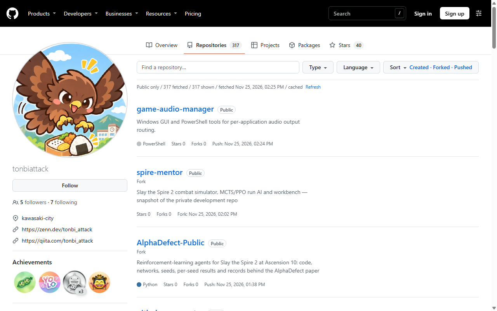
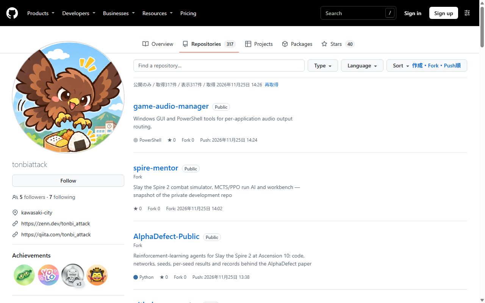

# GitHub Repo Sorter

An unofficial Chrome extension (Manifest V3) that sorts the repository list on a
GitHub profile page by recent activity, treating **creation, forks, and pushes**
as the same kind of activity.

It adds its options to GitHub's own **Sort** menu and reuses GitHub's search box
and Type / Language / Visibility filters, so there is no separate panel to learn.
No local server, no analytics, no third-party servers.

[日本語の説明](#日本語) · [Specification](docs/SPEC.md) · [Privacy](docs/PRIVACY.md) · [Implementation notes](docs/IMPLEMENTATION-NOTES.md)

> This project is not affiliated with GitHub, Inc.



The order lives in GitHub's own Sort menu. The list above is sorted by
"Created · Forked · Pushed" while GitHub's search box and filters stay in place.

## Features

- **Sort options in GitHub's own Sort menu**: integrated activity (default),
  creation, fork date, push date, and metadata update.
- **Uses GitHub's existing controls**: the search box, Type, Language, and
  Visibility menus all keep working; only the list itself is replaced.
- **Whole-list sorting**: every page is fetched from the API, then filtered,
  sorted, and paginated 30 rows at a time — not just the 30 rows on screen.
- **Rows show** name, link, description, visibility, fork/archived/template/
  mirror labels, language with GitHub's colour, star and fork counts, and the
  timestamp that produced the current order.
- **Light and dark themes** follow GitHub's own colour tokens.
- **English and Japanese UI**: follows the browser's display language
  (`_locales`), falling back to English for other languages.
- **Per-owner settings** are restored on your next visit.
- **Explicit states** for loading, empty, error, and partial results. If
  anything fails, GitHub's own list stays usable.
- **Optional read-only token** to include your private repositories.

## Install

The extension is not on the Chrome Web Store yet, so install it from source:

1. Download or clone this repository.
2. Run `npm ci` and `npm run build`.
3. Open `chrome://extensions` and enable **Developer mode**.
4. Choose **Load unpacked** and select this repository's `dist/` directory.

Then open `https://github.com/<owner>?tab=repositories`.

`dist/` is a build artifact. After changing source, run `npm run build` (or
`npm run watch`) and press the reload button on `chrome://extensions`.

> A store link will be added here once the listing is published. No unreleased
> link or badge is shown until then.

## Usage

- **Sort**: open GitHub's **Sort** menu and pick an entry under "Repo Sorter".
  The active order is shown on the Sort button and in the status line above the
  list.
- **Type / Language / Visibility**: use GitHub's own menus. They filter the whole
  fetched set before pagination.
- **Search**: GitHub's search box filters by name and description; multiple
  words must all match.
- **Refresh**: "Refresh" (再取得) bypasses the 5-minute memory cache.
- **Back to GitHub's list**: pick any standard entry in the Sort menu. The
  extension restores GitHub's list, search, and paging immediately.

### How the order is defined

- Integrated activity = `max(created_at, pushed_at)`
- Fork date = the fork's own `created_at` (verified against live API data)
- `updated_at` is excluded from the integrated order because it also changes on
  description edits; it is used only by the "metadata update" order
- Invalid or missing timestamps are excluded from comparison and sort last
- Ties break on `full_name` ascending, then `id`
- Timestamps are compared in UTC and displayed in local time

## Private repositories (optional)

1. Create a read-only token in GitHub → Settings → Developer settings.
   - **Recommended**: a fine-grained token with **Metadata: Read** on the
     repositories you want to include.
   - A classic token needs the `repo` scope. Note that `repo` is **not**
     read-only — it also grants write access.
2. Open the extension's options page (toolbar icon, or `chrome://extensions` →
   Details → Extension options).
3. Paste the token and press **Save and verify** (保存して検証).

By default the token is stored only in `chrome.storage.session`: it survives
service-worker restarts but not a browser restart, and it is never handed to a
content script. Ticking **Keep the token after a browser restart**
(ブラウザを再起動しても保持する) additionally stores it in `chrome.storage.local`,
which is plain text on disk — see [docs/PRIVACY.md](docs/PRIVACY.md) before
enabling it.

Authenticated and public listings use separate caches. If authentication fails
or the token belongs to another account, the extension shows an error and an
explicit **Load public list** (公開一覧として取得) action instead of silently
falling back.

## Permissions and privacy

- `permissions`: `storage` only
- `host_permissions`: `https://api.github.com/*` only
- Content script: `https://github.com/*`, active only on `/{owner}?tab=repositories`
- Network destination: `api.github.com` only. No analytics, no external servers,
  no GitHub cookie reuse.
- Repository data is cached in service-worker memory for 5 minutes and never
  persisted.
- HTML is rendered with `textContent`; API strings are never interpreted as markup.

## Language

The UI follows the browser's display language through Chrome's standard i18n
(`_locales/en` and `_locales/ja`, `default_locale: en`). Japanese is used when
the display language starts with `ja`; every other language falls back to
English. Dates and numbers are formatted with `Intl` for the active locale while
sorting still compares UTC timestamps. Repository names and descriptions are
never translated.

To verify a language explicitly, run the browser check with `--lang`:

```powershell
node scripts/browser-check.mjs --lang ja --probe
node scripts/browser-check.mjs --lang fr --probe   # falls back to English
```

## Development

| Command | Purpose |
| --- | --- |
| `npm run typecheck` | TypeScript type check |
| `npm test` | Unit and DOM integration tests (Vitest) |
| `npm run build` | Build the extension into `dist/` |
| `npm run watch` | Rebuild on change |
| `npm run icons` | Regenerate `icons/*.png` from source |
| `npm run package` | Build the store ZIP into `release/` |
| `npm run release` | `verify` then `package` |
| `npm run verify` | Type check → tests → build |
| `npm run check:browser` | Load the extension in a real Chromium and verify behaviour |

### Real-browser check

`npm run check:browser` drives Chromium over the Chrome DevTools Protocol.
Branded Chrome 137+ ignores `--load-extension`, so use Playwright's Chromium or
Chrome for Testing; set `CHROME_PATH` to point at it.

```powershell
$env:CHROME_PATH = "$env:LOCALAPPDATA\ms-playwright\chromium-1255\chrome-win64\chrome.exe"
npm run check:browser -- --owner tonbiattack
```

Verified on 2026-11-25 with Chromium 159 (headless):

- 316 public repositories across 4 pages: the rendered order matched an
  independent implementation of the sort
- Paging (page 2 = rows 31–60), search, Type/Language/Visibility, standard-sort
  restoration, reload, and a simulated Turbo DOM replacement
- Light `rgb(255,255,255)` / dark `rgb(13,17,23)` backgrounds
- With a token: 699 repositories (383 private), owner-mismatch error, and token
  removal

The check depends on the unauthenticated GitHub API rate limit (60 requests per
hour). `GRS_VERIFY_TOKEN` can supply a token for the independent expectation
fetch; `GRS_TEST_AUTH=1` also exercises the authenticated path in a throwaway
browser profile and clears it through the options page. Tokens are never printed
or written to the repository. Screenshots are written to
`dist/browser-check-{light,dark}.png` for public runs only.

### Layout

```
src/
  background/   service worker, message handling, storage
  content/      GitHub UI integration, rendering, Turbo handling
  options/      token and settings page
  shared/       API, sorting, filtering, protocol, cache (no DOM or chrome.*)
tests/          unit and jsdom integration tests
docs/           specification, implementation notes, privacy, store listing
scripts/        build, icons, packaging, browser check
```

## Known limitations

- Only `github.com/{owner}?tab=repositories` is supported (not the dashboard or
  search results).
- If GitHub's markup differs from the expected structure, the extension does not
  insert itself and leaves the standard listing untouched.
- Type values the API cannot reproduce (for example "Can be sponsored") fall back
  to the standard listing rather than being silently ignored.
- Rows are rendered from API data, so Star buttons, fork-parent links, and
  contribution graphs are not reproduced. The list links to the standard view
  for those actions.
- At most 100 pages (10,000 repositories) are fetched; beyond that the result is
  marked as partial.
- The 5-minute cache lives in service-worker memory and can be lost when the
  worker stops.
- Private repositories require a token; exact scopes depend on GitHub's policy.
- No license has been chosen yet.

## Uninstall

Remove the extension from `chrome://extensions`. Chrome deletes its stored data
with it. You can then delete `dist/`, `release/`, and `node_modules/`.

---

## 日本語

GitHub のプロフィールのリポジトリ一覧を、**作成・Fork・Push を同じ活動として**
扱い、最近触った順に並べ替える非公式の Chrome 拡張（Manifest V3）です。
GitHub 標準の **Sort** メニューに項目を追加し、検索欄と Type / Language /
Visibility は GitHub のものをそのまま使います。ローカルサーバー不要、外部送信なし。

> 本拡張は GitHub, Inc. とは関係ありません。



### 主な機能

- GitHub 標準の Sort メニューに「作成・Fork・Push順」（初期値）、作成順、
  Fork順、Push順、情報更新順を追加
- 検索欄・Type・Language・Visibility は GitHub 標準の操作をそのまま利用
- 全ページを取得してから絞り込み・並び替え・30 件ずつのページ分割
- 各行に名前・リンク・説明・公開範囲・Fork/Archived/Template/Mirror・
  言語（GitHub の色）・Star 数・Fork 数・並び順の基準日時を表示
- ライト / ダークは GitHub の配色に追従
- ブラウザの表示言語に応じて英語 / 日本語を自動切替（それ以外は英語）
- owner ごとに並び順・絞り込みを保存して復元
- 取得中・空・エラー・部分取得を明示。失敗時は GitHub 標準一覧をそのまま利用可能
- 任意の読み取り専用トークンで非公開リポジトリも対象

### 導入

ストア未公開のため、現時点ではソースから導入します。

1. このリポジトリを取得します。
2. `npm ci` と `npm run build` を実行します。
3. `chrome://extensions` でデベロッパーモードを有効にします。
4. 「パッケージ化されていない拡張機能を読み込む」で `dist/` を選択します。

その後 `https://github.com/<owner>?tab=repositories` を開きます。
ストア公開後はこの節に正式なストア URL を追加します（未公開リンクは載せません）。

### 使い方

- **並び替え**: GitHub の「Sort」メニューの Repo Sorter 項目を選びます。
  選択中の並び順は Sort ボタンと一覧上部のステータス行に表示されます。
- **対象・言語・公開範囲**: GitHub の Type / Language / Visibility を使用。
  全取得データに適用してからページ分割します。
- **検索**: GitHub の検索欄で名前・説明の部分一致。複数語は AND。
- **再取得**: 「再取得」で 5 分のメモリキャッシュを無視します。
- **標準表示**: Sort の GitHub 標準項目を選ぶと、元の一覧にすぐ戻ります。

### 並び順の定義

- 統合活動日時 = `max(created_at, pushed_at)`
- Fork日時 = Fork 先の `created_at`（実データで確認済み）
- `updated_at` は説明変更でも変わるため統合順では使わない（情報更新順のみ）
- 無効・欠損の日時は比較から除外し、全欠損は末尾
- 同値は `full_name` 昇順、最後に `id`
- 日時は UTC で比較し、表示はローカル時刻

### 非公開リポジトリ（任意）

fine-grained トークンで対象リポジトリの **Metadata: Read** のみを付与するのが
推奨です。クラシックトークンの `repo` スコープは**読み取り専用ではありません**。

既定では `chrome.storage.session` にのみ保存し、ブラウザ終了で消えます。
「ブラウザを再起動しても保持する」を有効にすると `chrome.storage.local` にも
保存されますが、これはディスク上に平文で残ります。共用 PC では有効にしないで
ください。詳細は [docs/PRIVACY.md](docs/PRIVACY.md) を参照してください。

### 制約

- 対象は `github.com/{owner}?tab=repositories` のみ
- GitHub の DOM が想定と異なる場合は挿入せず、標準表示のままにします
- API で再現できない Type（例: Can be sponsored）は標準表示へ戻します
- Star ボタン・Fork 元リンク・グラフは再現しません（標準表示への案内を表示）
- 最大 100 ページ（1 万件）で打ち切り、部分取得として表示
- ライセンスは未定

### アンインストール

`chrome://extensions` で削除します。`chrome.storage` のデータも一緒に消えます。
